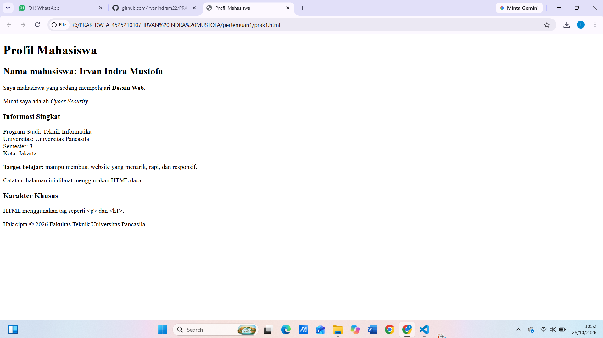

# 🎓 Profil Mahasiswa HTML

## 📌 Data Diri
- **Nama**: Irvan Indra Mustofa
- **NPM**: 4525210107
- **Prodi**: Teknik Informatika
- **Kampus**: Universitas Pancasila

## 📝 Ringkasan Project
Proyek sederhana ini merupakan bagian dari tugas praktikum **Desain Web**. Halaman ini memuat informasi personal, minat, dan target belajar yang dibangun murni menggunakan **HTML5 dasar**.

## 🛠️ Elemen HTML yang Digunakan
* `<h1>`–`<h3>` – Header & Judul
* `
` – Paragraf
* `<strong>` & `<b>` – Teks tebal
* `<em>` – Teks miring
* `<u>` – Garis bawah
* ` ` – Baris baru
* `&lt;` / `&gt;` – Karakter `<` dan `>`
* `&copy;` – Simbol ©

## 📸  Hasil
**Output:**

## 💡 Kesimpulan
Praktikum ini memberikan pemahaman mendalam tentang elemen dasar HTML, tata letak teks, serta cara menyajikan konten web yang rapi dan terstruktur.