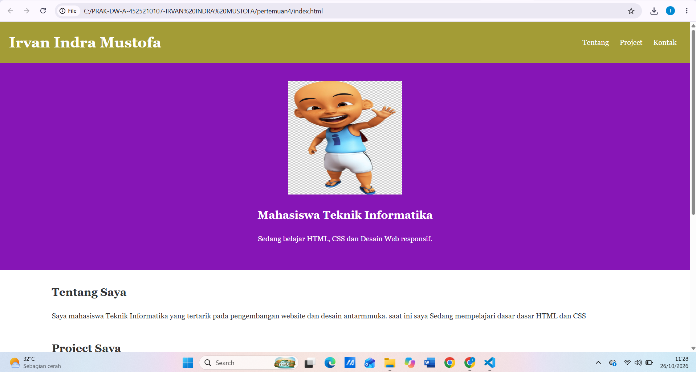
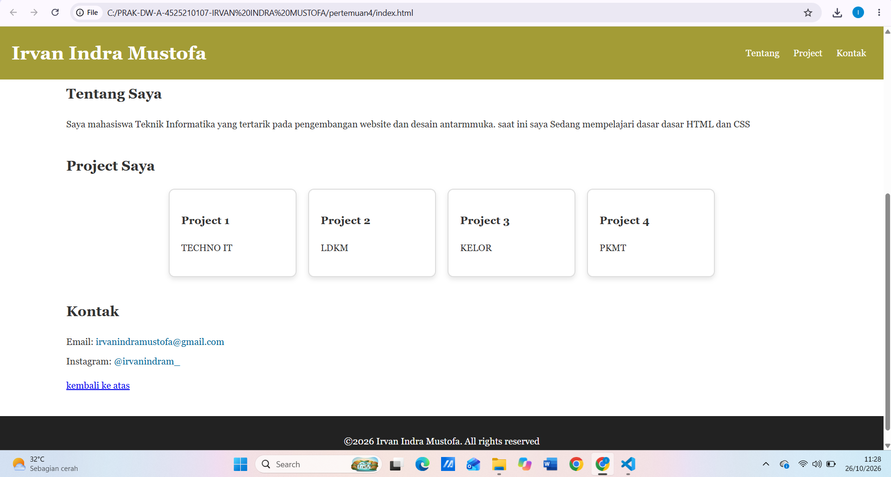
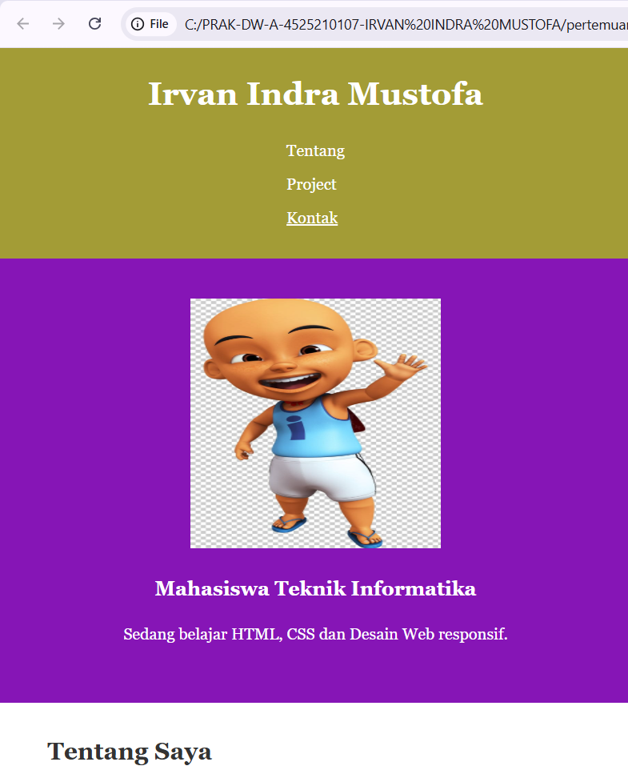

# 🎓 Profil 
- **Nama**: Irvan Indra Mustofa
- **NPM**: 4525210107
- **Prodi**: Teknik Informatika
- **Kampus**: Universitas Pancasila

# Portofolio Irvan Indra Mustofa

Website portofolio pribadi satu halaman yang dibuat dengan HTML dan CSS. Halaman ini memperkenalkan Irvan Indra Mustofa, mahasiswa Teknik Informatika, beserta project dan kontaknya.

## Fitur

- Header menempel di atas (sticky) dengan menu navigasi ke tiap bagian
- Bagian hero berisi foto profil dan deskripsi singkat
- Bagian **Tentang Saya**
- Bagian **Project** dalam bentuk kartu dengan efek hover
- Bagian **Kontak** (email dan Instagram)
- Tombol "kembali ke atas" dan footer
- Tampilan responsif untuk layar HP dan tablet (breakpoint 768px)

## Struktur Folder

```
.
├── index.html
├── css/
│   └── style.css
└── images/
    └── ipin.jpg
```

## Cara Menjalankan

1. Pastikan struktur folder sesuai di atas.
2. Buka `index.html` langsung di browser, atau gunakan ekstensi Live Server di VS Code.

## Teknologi

- HTML5
- CSS3 (Flexbox, media query, transition)

## Kontak

- Email: [irvanindramustofa@gmail.com](mailto:irvanindramustofa@gmail.com)
- Instagram: [@irvanindram_](https://www.instagram.com/irvanindram_/)

## Output



