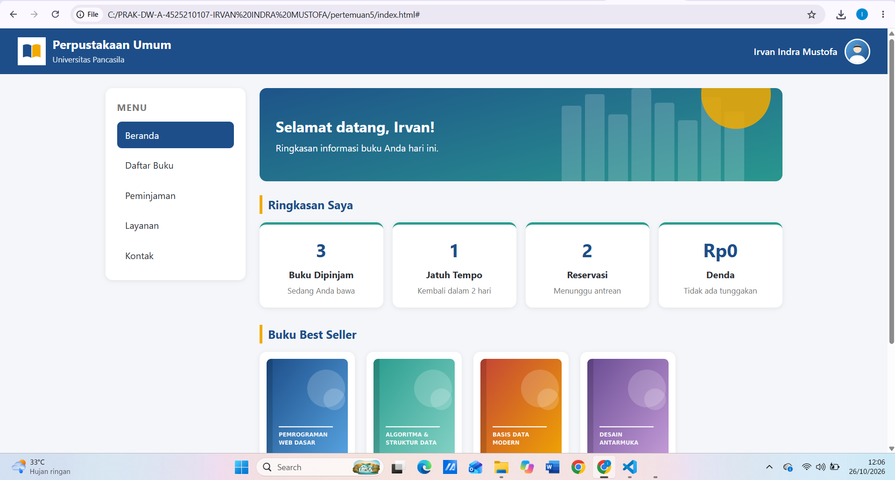
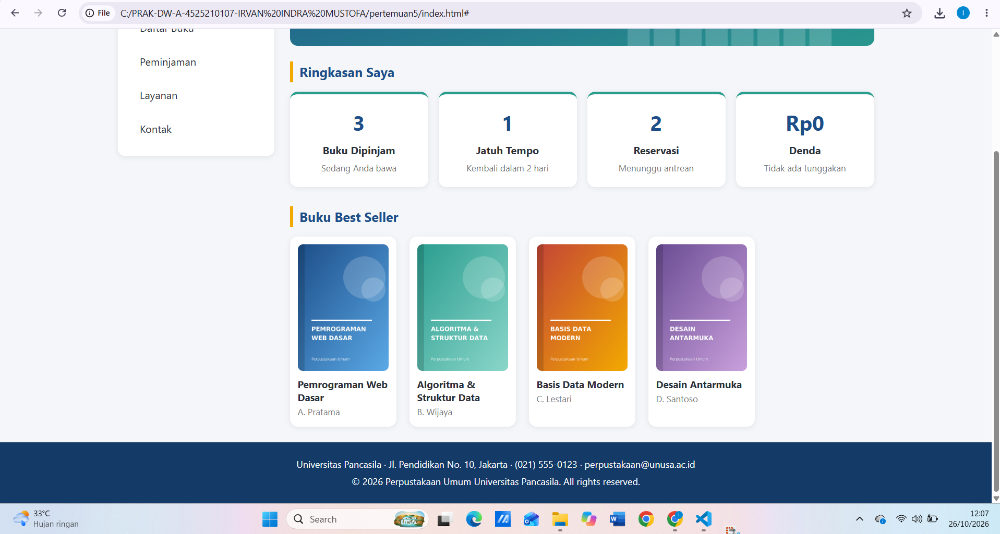
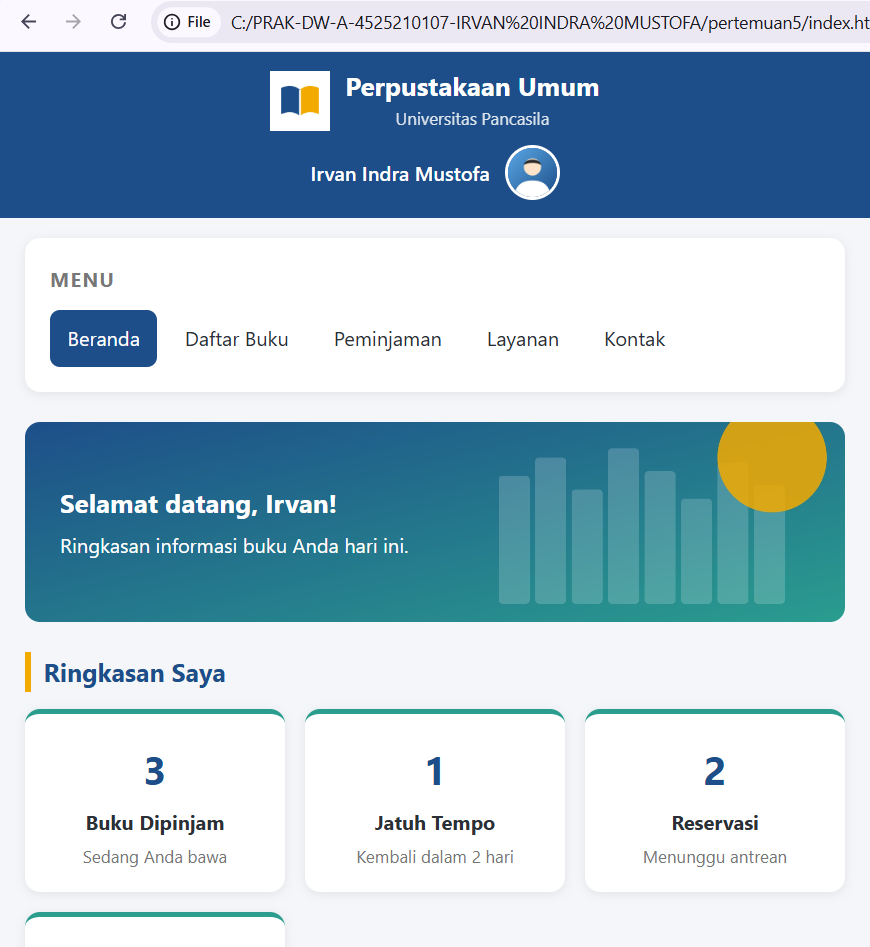
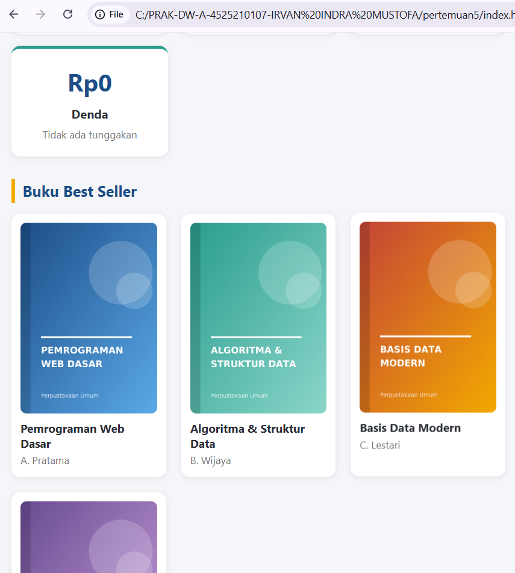
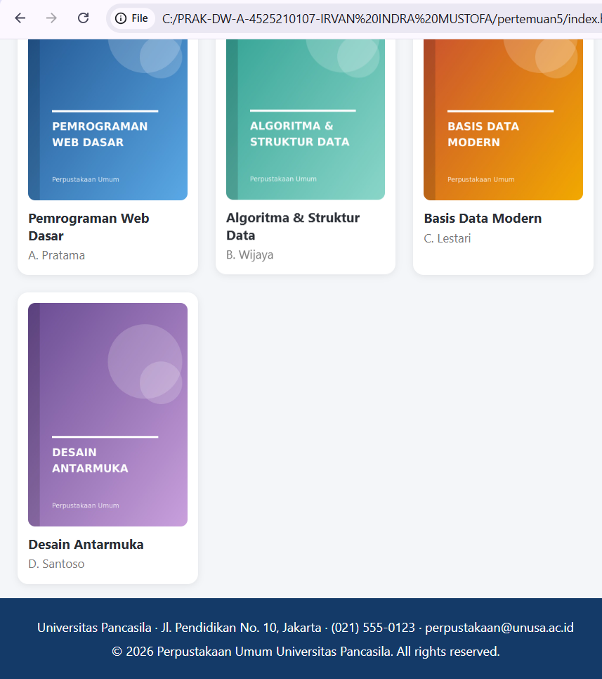

#  Profil 
- **Nama**: Irvan Indra Mustofa
- **NPM**: 4525210107
- **Prodi**: Teknik Informatika
- **Kampus**: Universitas Pancasila

# Dashboard Portal Perpustakaan Umum

Studi kasus Pertemuan 5 (Desain Web): wireframe awal Dashboard Portal Perpustakaan Umum yang dibuat dengan HTML dan CSS murni. Halaman ini membantu mahasiswa melihat ringkasan informasi buku dengan cepat.

## Struktur Layout

| Elemen | Tag | Isi |
|--------|-----|-----|
| Header | `<header>` | Logo perpustakaan (kiri), nama dan foto profil user (kanan) |
| Sidebar | `<aside>` | Menu vertikal: Beranda, Daftar Buku, Peminjaman, Layanan, Kontak |
| Konten utama | `<section class="content">` | Banner sambutan, kartu ringkasan, dan Buku Best Seller |
| Footer | `<footer>` | Informasi kontak universitas dan hak cipta |

Sesuai catatan pada soal ("pilih salah satu antara navbar atau sidebar"), proyek ini memakai **sidebar**.

## Fitur

- Layout utama dua kolom (sidebar dan konten) menggunakan CSS Grid
- Card grid ringkasan: Buku Dipinjam, Jatuh Tempo, Reservasi, dan Denda
- Daftar Buku Best Seller lengkap dengan sampul
- Efek hover pada menu dan kartu
- Responsif: pada layar 768px ke bawah, sidebar berubah menjadi menu horizontal yang bisa digeser

## Cara Menjalankan

1. Ekstrak folder proyek dan pastikan struktur folder tidak berubah.
2. Buka `index.html` di browser, atau gunakan ekstensi Live Server di VS Code.

## Teknologi

- HTML5 (tag semantik: `header`, `aside`, `main`, `section`, `article`, `footer`)
- CSS3 (Grid, Flexbox, CSS variables, media query)

## Output

# Mobile

