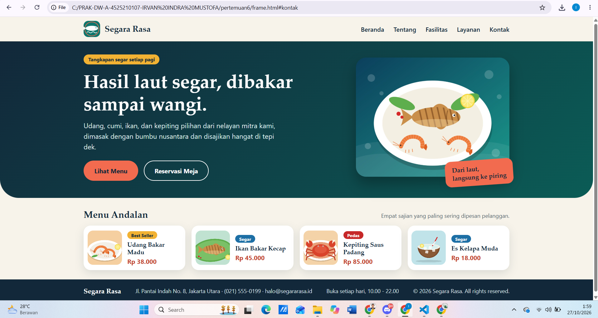
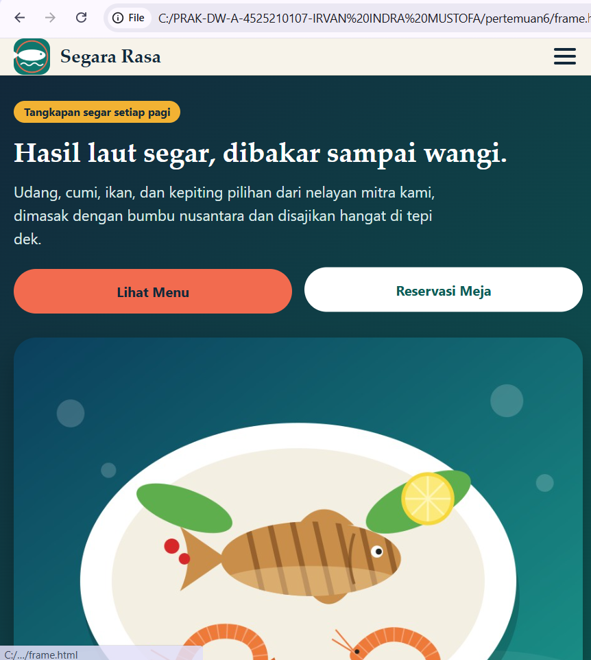

# Segara Rasa - Dashboard Profil Restoran Seafood

Halaman profil restoran seafood bakar bernama **Segara Rasa**, dibuat dengan HTML dan CSS murni. Halaman ini membantu pelanggan melihat ringkasan informasi restoran dengan cepat: menu andalan, fasilitas, layanan, dan kontak.

## Struktur Layout

| Elemen | Tag | Isi |
|--------|-----|-----|
| Navbar | `<nav>` | Logo restoran (kiri), menu horizontal: Beranda, Tentang, Fasilitas, Layanan, Kontak (kanan) |
| Head Banner | `<section class="head-banner">` | Highlight utama: judul, deskripsi, dua tombol aksi, dan gambar sajian |
| Tentang | `<section id="tentang">` | Cerita singkat restoran dan tiga angka ringkas |
| Area Konten Utama | `<section class="content">` | 6 menu andalan dalam bentuk kartu |
| Fasilitas | `<section id="fasilitas">` | 5 fasilitas dengan gambar (tata letak bento) |
| Layanan | `<section id="layanan">` | 4 layanan dengan ikon dan label |
| Footer | `<footer>` | Kontak, jam buka, dan hak cipta |

## Fitur

- Navbar menempel di atas (sticky) dengan hover garis aksen
- Palet warna konsisten lewat CSS variable: teal, navy, coral, emas, dan krem pasir
- Tata letak bento pada bagian Fasilitas dan kartu horizontal pada bagian Layanan
- Efek hover pada kartu menu dan gambar fasilitas
- Responsif tiga tingkat: desktop, tablet (992px ke bawah), dan mobile (768px ke bawah)

## Cara Menjalankan

1. Ekstrak folder dan jaga struktur foldernya.
2. Buka `index.html` di browser, atau gunakan ekstensi Live Server di VS Code.
3. Untuk melihat tampilan mobile: tekan **F12**, lalu **Ctrl + Shift + M**, atau perkecil lebar jendela di bawah 768px.

## Teknologi

- HTML5 (tag semantik: `nav`, `main`, `section`, `article`, `footer`, `address`)
- CSS3 (Grid, Flexbox, CSS variables, media query, transition)
- Font bawaan sistem (tanpa Google Fonts), sehingga tetap tampil rapi saat offline

## Output

# Mobile

&copy; 2026 Irvan Indra Mustofa
